# コンテンツ AI ソースの設定と管理

このガイドでは、前提条件を満たすことから、コンテンツソースの作成、インデックス作成と使用可能性の確認まで、Cloud Manager でコンテンツ AI ソースを設定する方法を順を追って説明します。

## 前提条件 {#prerequisites}

開始する前に、次の条件を満たしていることを確認してください。

* 1 つ以上の AEM as a Cloud Service 環境を持つアクティブな Cloud Manager プログラムがある。
* Cloud Manager 製品プロファイルがあり、Cloud Manager にログインできること。以下の [Cloud Manager へのアクセス権を取得](#cloud-manager-access)を参照してください。
* ユーザーがターゲット環境の **AEM ユーザー**&#x200B;製品プロファイルに割り当てられ、これによりコンテンツソースを表示できる。
* ユーザーがターゲット環境の **AEM 管理者**&#x200B;製品プロファイルに割り当てられ、これによりコンテンツソースを作成および編集できる。 Cloud Manager へのアクセス権のみでは不十分です。以下の [AEM 製品プロファイルへのユーザーの割り当て](#assign-product-profile)を参照してください。
* 環境の製品プロファイルが **Adobe Admin Console** でプロビジョニングされている。

## Cloud Manager へのアクセス権を取得 {#cloud-manager-access}

「**[!UICONTROL コンテンツ AI 設定]**」タブを開くには、Cloud Manager UI にアクセスする必要があります。 組織の [!DNL Adobe Admin Console] 管理者（システム管理者または製品管理者）がこのアクセス権を付与します。

1. [[!DNL Adobe Admin Console]](https://adminconsole.adobe.com/) 管理者にお問い合わせください。 まだ組織のメンバーでない場合は、管理者に Adobe ID またはメールアドレスの追加を依頼してください。
1. 組織の AEM as a Cloud Service プログラム用の Cloud Manager 製品プロファイルを割り当てるように管理者に依頼します。

   | 製品プロファイル | 許可される操作 |
   | --- | --- |
   | **[!UICONTROL ビジネスオーナー]** | プログラムを管理します。 **[!UICONTROL アクセス権の管理]**&#x200B;など、幅広い Cloud Manager 権限を持っています。 |
   | **[!UICONTROL デプロイメントマネージャー]** | 環境、デプロイメント、パイプラインを管理します。 |
   | **[!UICONTROL プログラムマネージャー]** | チーム設定とプログラム監視を行います。 |
   | **[!UICONTROL 開発者]** | コードと Git を扱います。 Cloud Manager 権限は制限されています。 |

1. Cloud Manager を開くには、[Cloud Manager](https://my.cloudmanager.adobe.com/) にログインするか、[[!DNL Adobe Experience Cloud]](https://experience.adobe.com/) > **[!DNL Experience Manager]** > **[!UICONTROL Cloud Manager]** に移動します。 お使いの Adobe ID が複数の組織に属している場合は、正しい組織を選択してください。

>[!NOTE]
>
>Cloud Manager 製品プロファイルでは、コンテンツソースへのアクセス権はありません。 環境に対して、**[!UICONTROL AEM ユーザー]**&#x200B;または **[!UICONTROL AEM 管理者]**&#x200B;製品プロファイルも必要です。[AEM 製品プロファイルへのユーザーの割り当て](#assign-product-profile)を参照してください。 デフォルトの Cloud Manager ユーザーロールのみを持つユーザーは、環境を開くことはできますが、プログラムレベルのアクセス権は付与されません。

ログインしてもプログラムまたは「**[!UICONTROL コンテンツ AI 設定]**」タブが表示されない場合は、割り当てられた製品プロファイルの確認を管理者に依頼してください。 また、ログイン時に正しい組織を選択したことも確認してください。 AEM Managed Services では、AEM as a Cloud Service とは異なる [!DNL Admin Console] 製品コンテキストと設定を使用します。

最初のオンボーディング中にプログラムを作成するには、システム管理者が最初に&#x200B;**[!UICONTROL ビジネスオーナー]**&#x200B;プロファイルを保持した状態で、Cloud Manager にログインする必要があります。

詳しくは、次を参照してください。

* [Cloud Manager 製品プロファイルへのチームメンバーの割り当て](https://experienceleague.adobe.com/ja/docs/experience-manager-cloud-service/content/onboarding/journey/assign-profiles-cloud-manager)
* [Cloud Manager へのアクセス](https://experienceleague.adobe.com/ja/docs/experience-manager-cloud-service/content/onboarding/journey/cloud-manager)
* [AEM as a Cloud Service のチームおよび製品プロファイル](https://experienceleague.adobe.com/ja/docs/experience-manager-cloud-service/content/onboarding/concepts/aem-cs-team-product-profiles)
* [ユーザーと役割の追加](https://experienceleague.adobe.com/ja/docs/experience-manager-cloud-manager/content/requirements/users-and-roles)

## AEM 製品プロファイルへのユーザーの割り当て {#assign-product-profile}

特定の環境に対する [!DNL Adobe Experience Manager] as a Cloud Service へのアクセス権をユーザーに付与するには、次の手順に従います。 ユーザーが必要とするアクセス権に一致するプロファイルを割り当てます。

* **[!UICONTROL AEM ユーザー]** - コンテンツソースを表示します。
* **[!UICONTROL AEM 管理者]** - コンテンツソースを作成および編集します。

>[!NOTE]
>
>AEM にアクセスするには、ユーザーは **[!UICONTROL AEM ユーザー]**&#x200B;や **[!UICONTROL AEM 管理者]**&#x200B;などの AEM 製品プロファイルに属している必要があります。 Cloud Manager へのアクセス権のみでは不十分です。

これらのプロファイルを割り当てるには、[!UICONTROL ビジネスオーナー Cloud Manager 製品プロファイル]を持つシステム管理者である必要があります。 ユーザーの名前とメールアドレスを準備します。

1. [Cloud Manager](https://my.cloudmanager.adobe.com/) でプログラムに移動し、ターゲット環境の「**[!UICONTROL アクセスを管理]**」を選択します。 新しいタブで、その環境の [!DNL Adobe Admin Console] が開きます。
1. **オーサー**&#x200B;層と&#x200B;**パブリッシュ**&#x200B;層の両方に、**[!UICONTROL AEM ユーザー]**&#x200B;または **[!UICONTROL AEM 管理者]**&#x200B;製品プロファイルを選択してください（例えば、`AEM Administrators - author - Program 12345 - Environment 67890` や `AEM Administrators - publish - Program 12345 - Environment 67890`）。
   * **[!UICONTROL AEM ユーザー]** – 読み取り専用の操作。
   * **[!UICONTROL AEM 管理者]** - コンテンツソースの作成、編集、削除、獲得のトリガーなどの書き込み操作。
1. 「**[!UICONTROL ユーザーを追加]**」を選択します。
1. ユーザー名とメールアドレスを入力し、変更を保存します。 ユーザーが製品プロファイルに追加されます。

開発、ステージング、本番など、ユーザーがアクセスを必要とする各環境で、これらの手順を繰り返します。

>[!CAUTION]
>
>**[!UICONTROL AEM 管理者]**&#x200B;または **[!UICONTROL AEM ユーザー]**&#x200B;という名前のデフォルトの製品プロファイルは、編集または削除しないでください。 **[!UICONTROL AEM 管理者]**&#x200B;の名前を変更すると、その役割が割り当てられているすべてのユーザーから管理者権限が削除されます。

### 割り当ての確認 {#verify-assignment}

割り当てが成功したことを確認するには：

1. [!DNL Admin Console] で、割り当てた製品プロファイルを再度開きます。
1. ユーザーがメンバーリストに表示されていることを確認します。

アクセスやトークンに関する問題をトラブルシューティングする際は、ユーザーがグループを通じてだけでなく、製品プロファイルに直接追加されていることを確認します。

## 手順 1 -「コンテンツ AI 設定」タブを開く {#open-tab}

1. [Cloud Manager](https://my.cloudmanager.adobe.com/) にログインし、プログラムを選択します。

   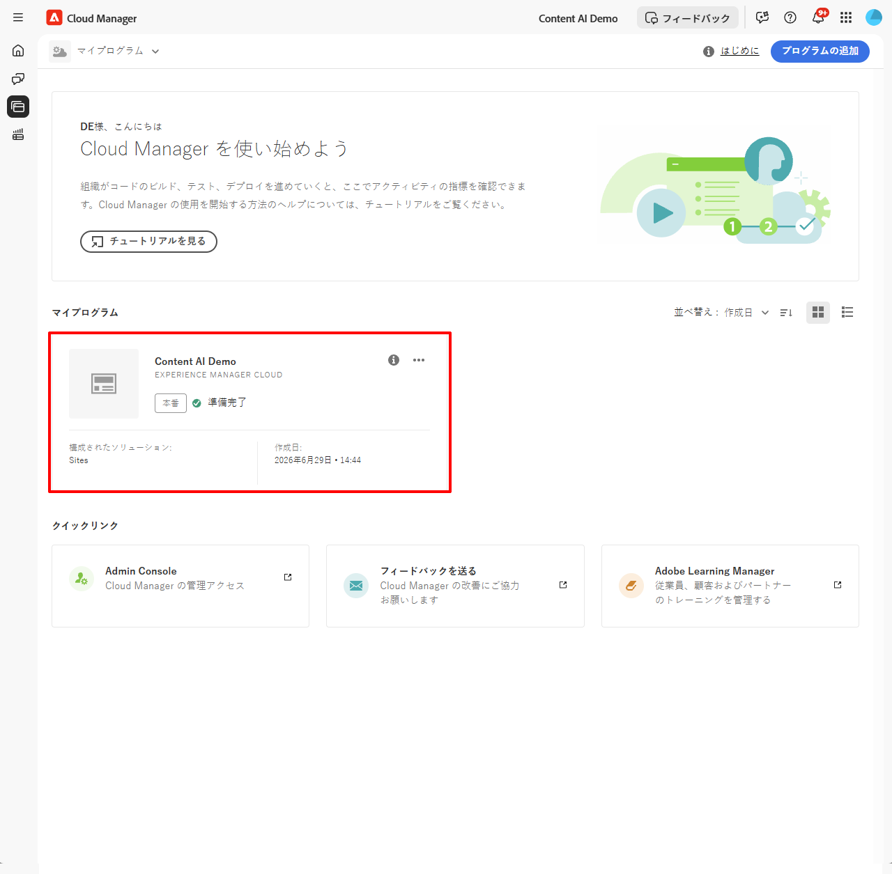

1. **[!UICONTROL プログラムの概要]**&#x200B;から、「**[!UICONTROL 環境]**」セクションを見つけ、設定する環境を選択します。

   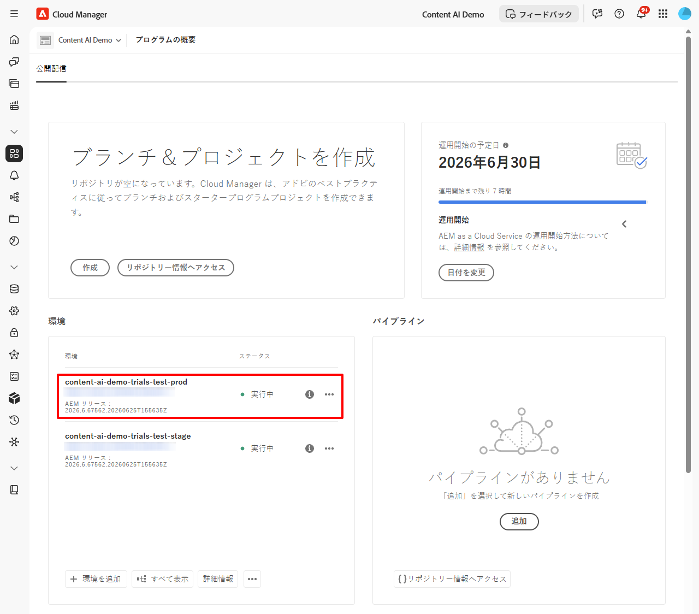

1. 環境の詳細ページで、「**[!UICONTROL コンテンツ AI 設定]**」タブを選択します。

   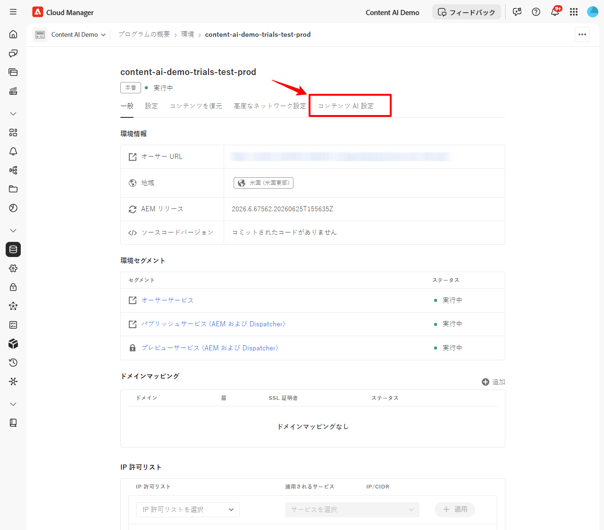

## 手順 2 - コンテンツ AI ソースを作成 {#create-source}

コンテンツソースでは、コンテンツ AI がクロールしてインデックス作成する web サイトを定義します。

1. 「**[!UICONTROL コンテンツ AI 設定]**」タブで、「**[!UICONTROL ソースを作成]**」を選択します。

   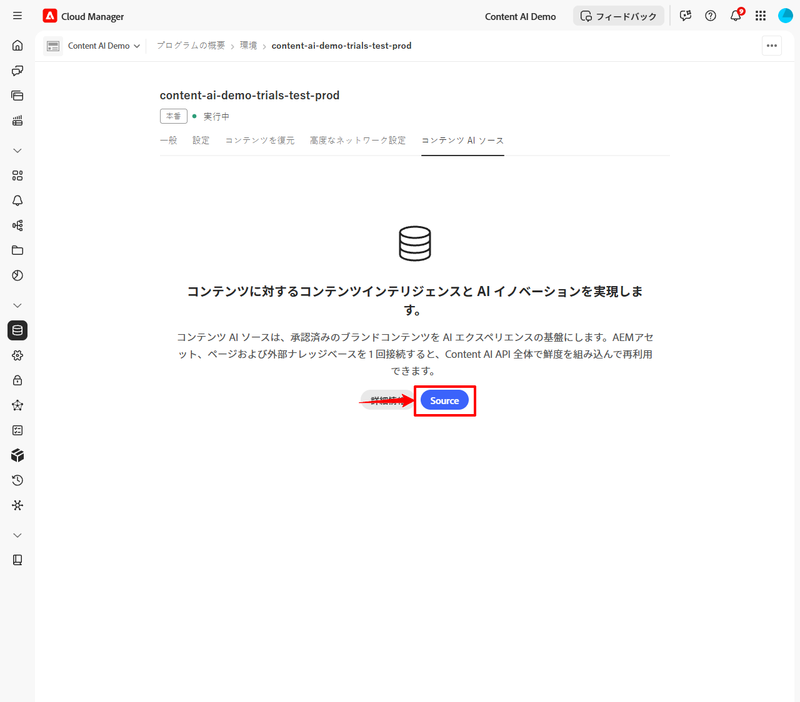

1. **[!UICONTROL 新規コンテンツ AI ソースを作成 / 追加]**&#x200B;ダイアログで、次のフィールドに入力します。

   | フィールド | 説明 |
   | --- | --- |
   | **[!UICONTROL コンテンツ AI 設定名]** | このソースの一意の ID（例：`my-site-index`）。 作成後は変更できません。 |
   | **[!UICONTROL 説明]** | *（オプション）* コンテンツソースの短い説明。 |
   | **[!UICONTROL Web サイトアドレス]** | クロールする web サイトのルート URL（例：`https://www.example.com/`）。 |
   | **[!UICONTROL URL を除外]** | *（オプション）*&#x200B;クロール中にスキップする URL パターン。 |
   | **[!UICONTROL 更新頻度]** | コンテンツ AI がソースを再クロールする頻度：週単位、日単位、日単位 4 回、60 分または 15 分。 |

   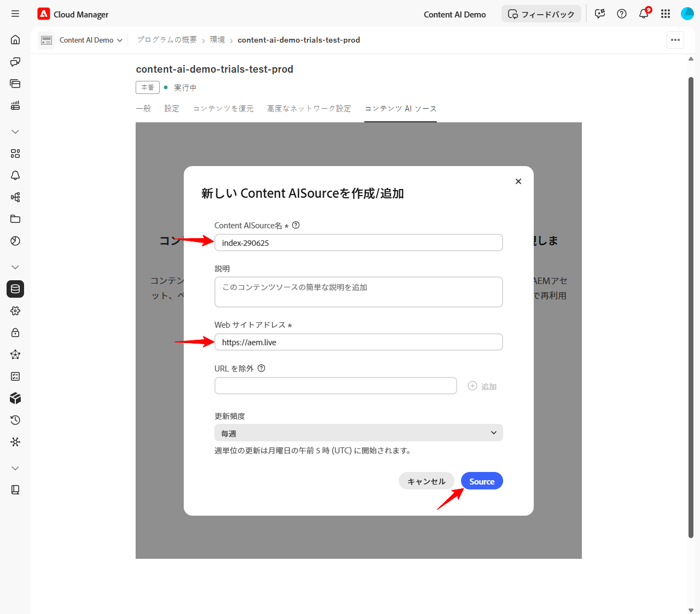

   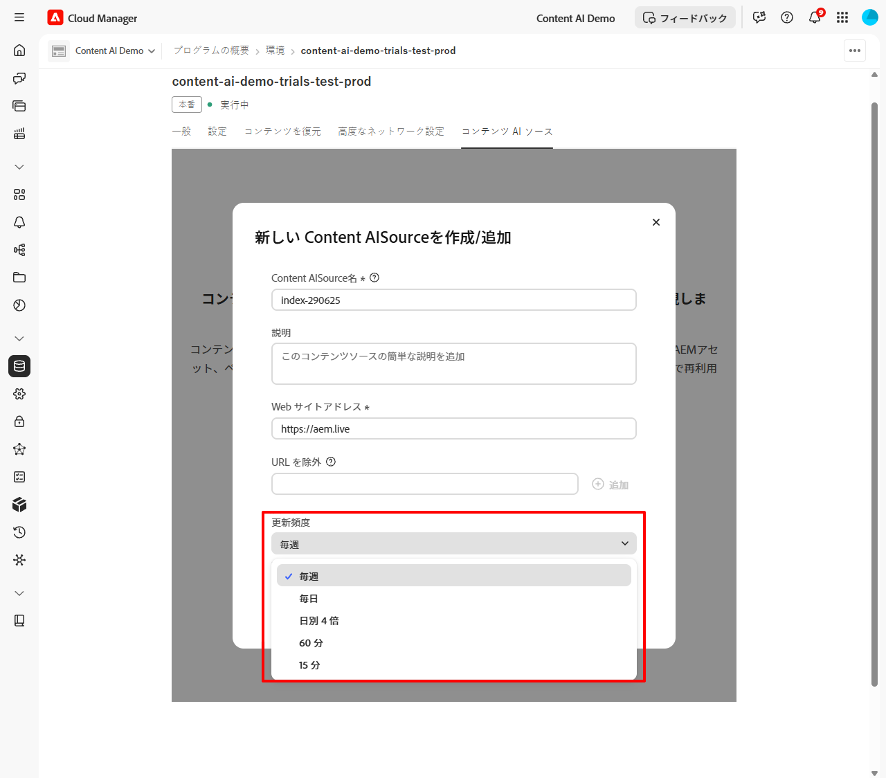

1. 「**[!UICONTROL ソースを作成]**」を選択します。 獲得が自動的に開始され、ソースは&#x200B;**インデックス作成**&#x200B;に移行します。

   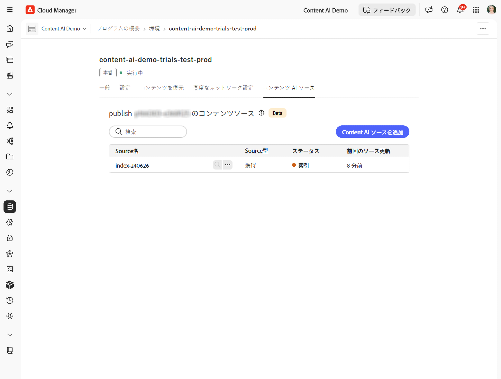

## 手順 3 - 獲得を再実行 {#trigger-acquisition}

ソースを作成すると獲得が自動的に実行され、その後は&#x200B;**[!UICONTROL 更新頻度]**&#x200B;で設定したスケジュールに従って実行されます。 また、新しいコンテンツを公開した直後にインデックスを再作成するなど、いつでも手動で実行をトリガーできます。

1. ソースリストで、ソースの横にある&#x200B;**その他のアクション**（…）アイコンを選択し、「**[!UICONTROL 獲得をトリガー]**」を選択します。

   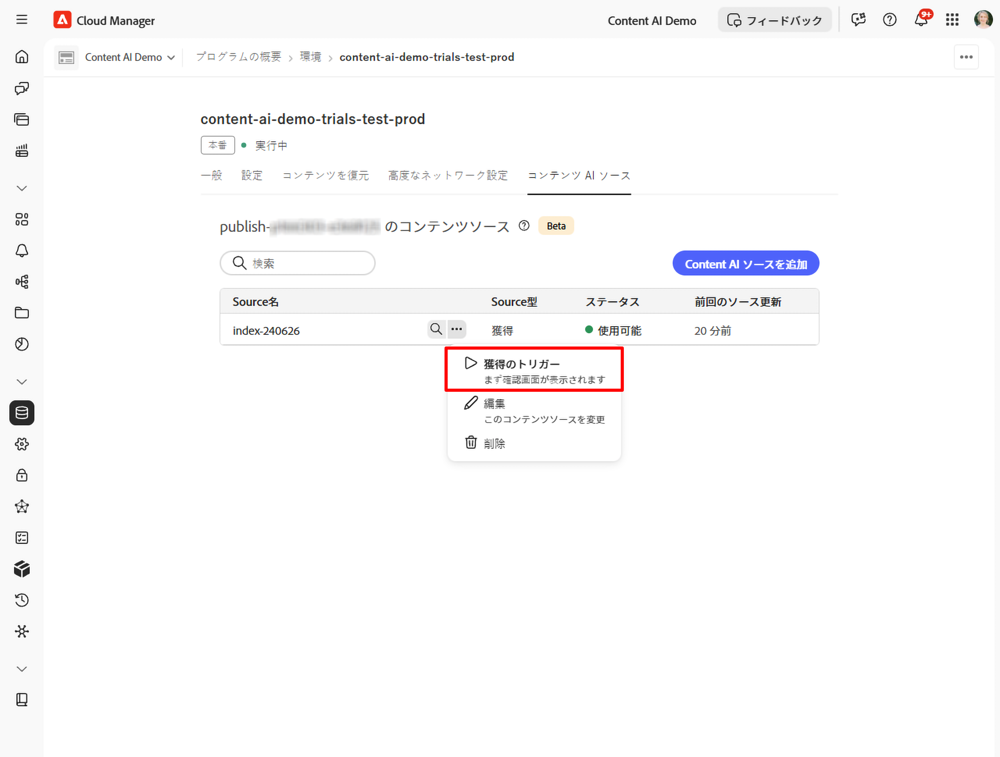

1. **[!UICONTROL 獲得をトリガー]**&#x200B;ダイアログで、ソースの詳細（**[!UICONTROL コンテンツソース]**、**[!UICONTROL 前回の実行]**、**[!UICONTROL 次のスケジュールされた実行]**）を確認し、「**[!UICONTROL トリガー]**」を選択します。

   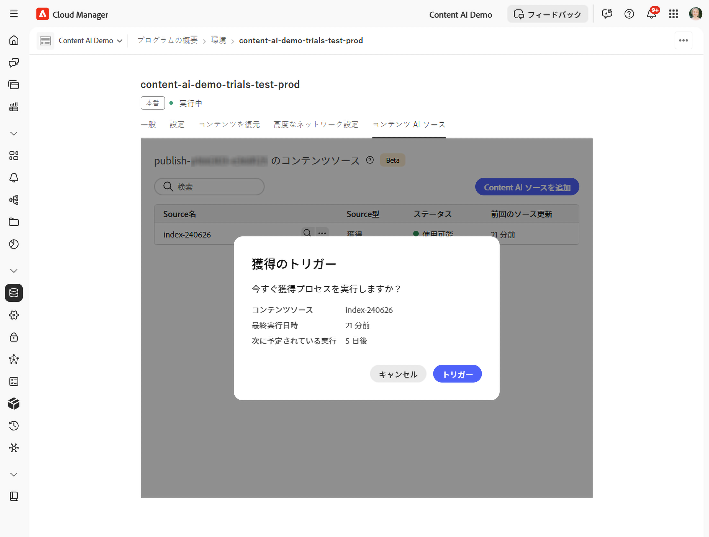

## 手順 4 - インデックス作成ステータスを監視 {#monitor-status}

獲得が開始されると、ソースステータスはリアルタイムで更新されます。

| ステータス | 意味 |
| --- | --- |
| **新規** | ソースが作成されたばかりです。自動獲得はまだ開始されていません。 このステータスは一時的なものです。 |
| **インデックス作成** | 獲得は処理中です。コンテンツのクロールとインデックス作成が実行されています。 |
| **使用可能** | インデックス作成が完了しました。ソースは検索クエリを提供する準備が整いました。 |

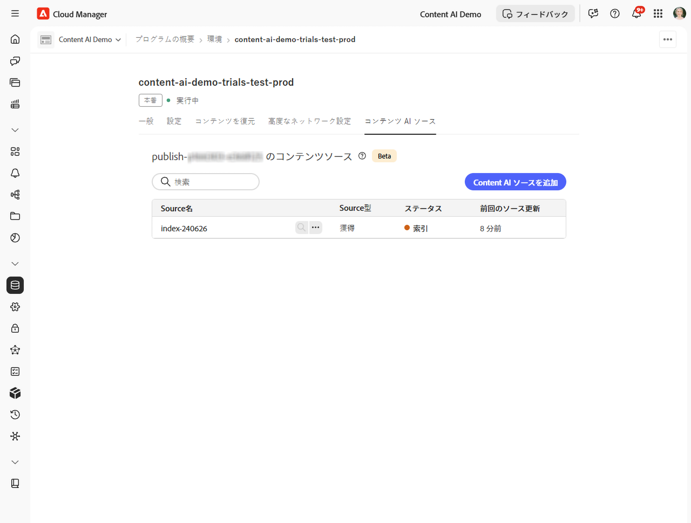

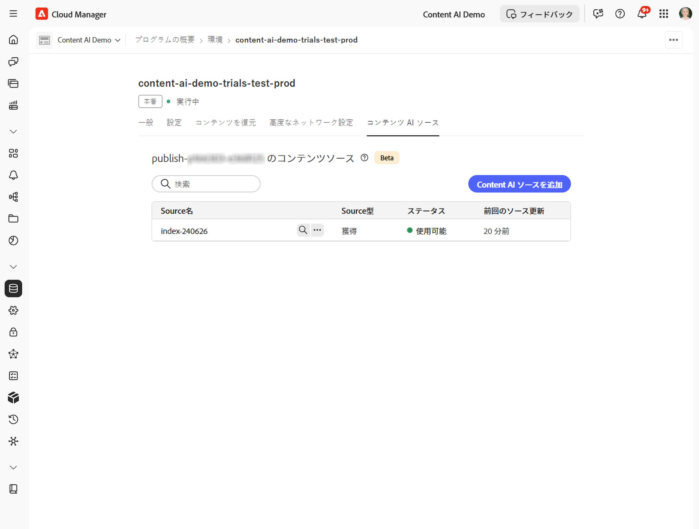

インデックスの検索や API のテストを実行する前に、ステータスが&#x200B;**使用可能**&#x200B;に達するまで待機します。

## 手順 5 - インデックス作成済みコンテンツを検索 {#search-content}

ソースステータスが&#x200B;**使用可能**&#x200B;になったら、Cloud Manager から直接検索クエリを実行して、コンテンツが正しくインデックス作成されていることを確認できます。

1. ソースリストで、ソースの横にある&#x200B;**検索**（虫眼鏡）アイコンを選択します。

   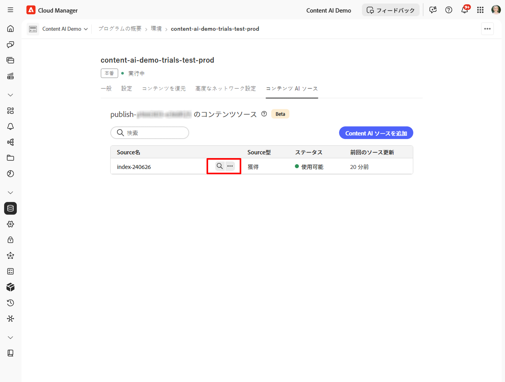

1. 検索フィールドにクエリを入力します。 結果には、一致スコアとコンテンツタイプ（例：**ページ**&#x200B;または **PDF**）と一致する項目のリストが表示されます。 結果を選択すると、右側にプレビューが開きます。

   

## ソースの変更または削除 {#modify-source}

### ソースの変更 {#modify}

ソース設定を作成後に更新するには：

1. ソースリストで、ソースの横にある&#x200B;**その他のアクション**（…）アイコンを選択し、「**[!UICONTROL 編集]**」を選択します。

   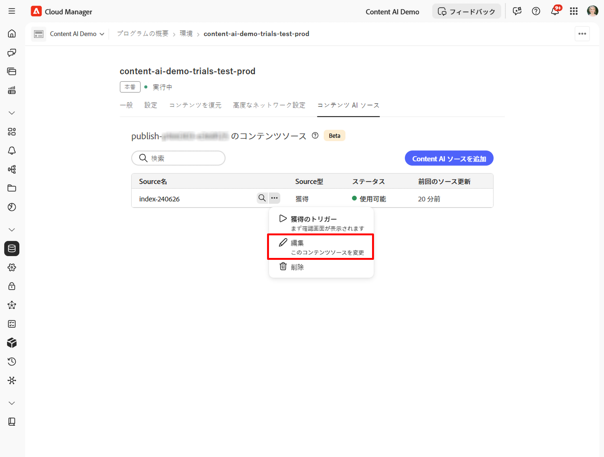

1. **[!UICONTROL コンテンツ AI ソースを変更]**&#x200B;ダイアログで、必要に応じて&#x200B;**[!UICONTROL 説明]**、**[!UICONTROL Web サイトアドレス]**、**[!UICONTROL URL を除外]**&#x200B;または&#x200B;**[!UICONTROL 更新頻度]**&#x200B;を更新します。 **[!UICONTROL コンテンツ AI 設定名]**&#x200B;は、読み取り専用で、変更できません。

   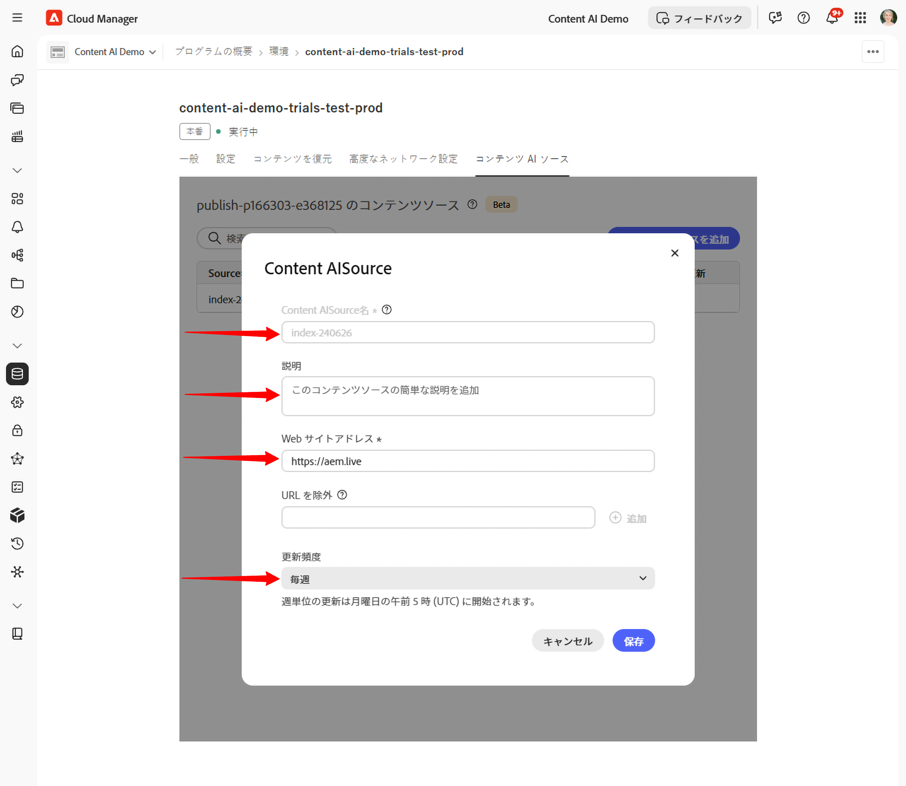

1. 「**[!UICONTROL 保存]**」を選択して、変更を適用します。 ソースリストが更新され、変更が反映されます。

### ソースの削除 {#delete}

1. ソースリストで、ソースの横にある&#x200B;**その他のアクション**（…）アイコンを選択し、「**[!UICONTROL 削除]**」を選択します。

   >[!WARNING]
   >
   >ソースの削除は永続的です。 そのソースのすべてのインデックス作成済みコンテンツは削除され、検索クエリを提供できなくなります。

削除後、ソースはリストに表示されなくなります。

## 次の手順 {#next-steps}

* [Adobe Developer Console プロジェクトの設定](setup-adc-project.md) - API を呼び出すために必要な ADC プロジェクトと資格情報を作成します。
* [Content AI API リファレンス](https://developer.adobe.com/experience-cloud/experience-manager-apis/api/stable/contentai/) - セマンティック、フルテキストまたはハイブリッド検索エンドポイントを使用して、インデックス作成済みコンテンツのクエリを実行します。

## トラブルシューティング {#troubleshooting}

* **ソースが[!UICONTROL インデックス作成]中に長期間留まります。** （…）メニューから獲得を再試行します。 2 回目の実行後にステータスが進まない場合は、**[!UICONTROL web サイトアドレス]**&#x200B;が公開可能であることと、**[!UICONTROL URL を除外]**&#x200B;パターンがすべてのページを除外していないことを確認してください。
* **ソースが実行後に[!UICONTROL 新規]に戻ります。** クローラーは、設定済みルート URL からページを取得できませんでした。 URL が `200 OK` で応答し、サイトが自動リクエストをブロックしていないことを確認してください。
* **[!UICONTROL 検索]では、[!UICONTROL 使用可能]なソースの結果が返されません。** インデックス作成は成功しましたが、クエリに一致するコンテンツはありませんでした。 より広範なクエリを試すか、クロールされた URL に期待するページが含まれているかどうかを確認してください。
