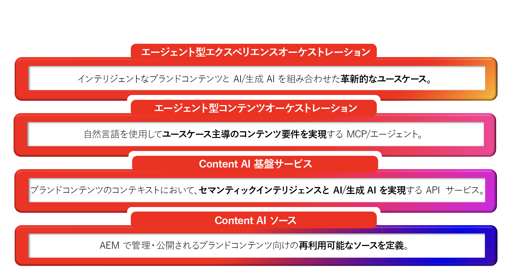

# AEM コンテンツ AI - 概要

## インテリジェントコンテンツ、AI 対応のバイデザイン {#ai-ready}

顧客は、web サイトにアクセスする前に、AI を通じてブランドと接する機会が増えています。 チャットアシスタント、AI の概要、エージェント、対話型検索、AI コンシェルジュなど、これらはすべてブランドの代わりにブランドコンテンツを取得、要約、提示します。 これらの AI が提供する内容は、リーチできるコンテンツの正確性、最新性、ブランドに即したものに左右されます。
AEM コンテンツ AI は、まさにこの変化に対応することを目的に作成されています。 ブランドコンテンツを AI エクスペリエンスが動作する基盤となる真実として処理し、オーサーサイドでより迅速にその基盤となる真実を作成し、パブリッシュサイドで消費者向け AI 駆動型エクスペリエンスに適切に提供するツールを AEM の顧客に付与します。

**オーサーサイドでは**、AEM コンテンツ AI は承認済みのブランドソースに基づいてコンテンツを作成します。 AI の支援によるオーサリング、既存のページコンテンツ、フラグメント、アセットをまたいだ自然言語によるコンテンツ検出、ブランド認識に基づくコンテンツ生成により、チームは AEM から離れることなく、既に承認済みのコンテンツから逸脱することなく、新しいオーディエンス、地域、チャネル向けにバリエーションを作成できます。

**パブリッシュサイドでは**、同じコンテンツが構造化され、管理され、AI が消費できるようになっています。 フラグメント、メタデータ、分類、承認済みソースは、検索システム、エージェント、対話型インターフェイスが自信を持って使用できる形式で公開されるので、AI がブランドを代弁する際は、ブランドの真実を語ることになります。

### AEM の顧客にとっての意味 {#what-it-means}

承認済みコンテンツは、ブランドが誤った情報に惑わされないための防御策です。 AI が管理された AEM コンテンツに基づいている場合、回答はデフォルトで正確性、最新性、ブランドに即したものが保持されます。
オーサリングは AI 時代の需要に対応します。 チームは、オーサリングエクスペリエンス内で、より多くのオーディエンスと瞬間に対応するコピーと画像を生成します。これは、ゼロから始めるのではなく、承認済みソースから描画することで実現します。
検出は人物と機械が実際に質問するのと同じように機能します。 アセット、フラグメント、ページ、フォームをまたいだ自然言語によるインテントベースの検索により、既存のコンテンツが再利用可能なリソースへと生まれ変わります。
パーソナライゼーションは、複製ではなく再利用によって拡張されます。 管理されたコンポーネントは、追跡されないコピーに増殖する代わりに、バリアントに再結合されます。
パブリッシュチャネルに AI サーフェスが含まれるようになりました。 コンテンツは、人間、エージェント、AI を介したエクスペリエンスのすべてが消費できる形式で配信されます。それぞれに個別のパイプラインを用意する必要はありません。

**さらに大きなポイント：既存の信頼できるブランドコンテンツの価値がこれまで以上に高まっています。 AEM に既に存在する承認済みのフラグメント、アセット、ページはすべて、AI 駆動型エクスペリエンスが依存する基盤となる真実となります。AEM コンテンツ AI は、そのライブラリを再利用可能、発見可能にし、次世代のコンテンツを支える準備を整えます。**

## 一目でわかる AEM コンテンツ AI {#at-a-glance}

AEM コンテンツ AI は、4 つのレイヤーのスタックとして構造化されています。基盤となる信頼できるコンテンツから、上位で機能するエージェント型エクスペリエンスまで、各レイヤーは下位のレイヤーの上に作成されています。

*基盤となる信頼できるコンテンツから上位で機能するエージェント型エクスペリエンスまで、下から上の順にスタックを参照してください。*

1. コンテンツ AI ソース
コンテンツソースは、信頼できるコンテンツ本文に接続される AEM コンテンツ AI の管理エンティティです。 コンテンツソースでは、アセット、コンテンツフラグメント、ページ、フォーム、メタデータ、分類など、AEM が管理するコンテンツタイプと、サードパーティの web サイト、ナレッジベース、ドキュメントポータルなどの AEM 以外のソースを参照できます。 各コンテンツソースは、自動的にベクター化され、セマンティックに強化されるので、検索、グラウンディング、対話型 AI エクスペリエンスが実現します。 コンテンツソースを一度定義すると、自動更新とビルトインの更新機能により、Content AI API をまたいで再利用できます。

1. コンテンツ AI 基盤サービス
ブランドコンテンツのコンテキストで、セマンティックインテリジェンスと生成 AI を有効にする API とサービス。 コンテンツ AI ソースを基盤として、これらのサービスは、顧客が承認済みコンテンツに基づき、検索、生成、ブランド認識に基づくバリエーション、最適化といった機能を提供します。

1. エージェント型コンテンツオーケストレーション
ユースケース駆動型のコンテンツ要件を自然言語で連携アクションに変換する MCP とエージェント。 このレイヤーにより、オーサーや他のエージェントは必要な内容をプレーンな言語で記述でき、これを満たすための適切な基盤サービスが調整されます。

1. エージェント型エクスペリエンスオーケストレーション
インテリジェントなブランドコンテンツと大規模な AI の組み合わせにより生まれる革新的なユースケース。 AEM ソリューション自体はこれらの基盤サービス上に作成され、顧客は同じ API を直接使用して、独自のコンテンツ上で独自のエージェント型エクスペリエンスを作成できます。 AI を活用したコンテンツサプライチェーンから対話型のユーザージャーニーまで、このレイヤーこそが、競争上の優位性となる管理されたコンテンツです。

これらのレイヤーはバイデザインで接続しています。すべての AI サービスはコンテンツ基盤から情報を取得し、生成されたすべてのコンテンツは同じ管理されたシステムにフローバックされます。つまり、オーサーサイドの作成とパブリッシュサイドの配信は、信頼できる唯一の情報源を共有します。

## 実際の AEM コンテンツ AI {#action}

コンテンツ AI を正常に動作させるには、次の 2 つのタスクが必要です。

### &#x200B;1. AEM 環境でコンテンツAI を有効にする {#enable}

**前提条件：**&#x200B;コンテンツ AIの使用を開始する前に、AEM as a Cloud Service 環境にスコープされた API 資格情報が必要です。 詳しくは、[Adobe Developer Console プロジェクトの設定](setup-adc-project.md)を参照してください。

### &#x200B;2. コンテンツ AI ソースを制御 {#control}

AI ベースのエクスペリエンスを有効にするには、コンテンツ AI ソースを設定および管理します。詳しくは、[コンテンツソースの制御](contentsources.md)を参照してください。

## Content AI API について学ぶ  {#apis}

AEM コンテンツ AI の機能の幅広さについて - API は、プラットフォームの潜在能力を最大限に引き出します。 [Content AI API](https://developer.adobe.com/experience-cloud/experience-manager-apis/api/experimental/contentai/) を参照してください。
