# Adobe Developer Console プロジェクトの設定 {#configure-adc-project}

AEM Content AI Services API を呼び出すには、Adobe Developer Console（ADC）プロジェクトによって発行された資格情報が必要です。 このページでは、プロジェクトの作成、認証方法の選択、すべての API リクエストに含める資格情報の生成を順に追って説明します。

開始するには、組織の [Adobe Developer Console](https://developer.adobe.com/console/) に移動します。

## 前提条件 {#prerequisites}

開始する前に、次の点を確認してください。

* 組織で [Adobe Developer Console](https://developer.adobe.com/console/) へのアクセス権があること。
* **Adobe Admin Console** の AEM コンテンツ AI サービス製品プロファイルに&#x200B;**開発者**&#x200B;として追加されていること。 この役割がない場合、**[!UICONTROL AEM Content AI Services]** API カードは無効になり、**[!UICONTROL サーバー間]**&#x200B;認証オプションは非表示になります。
* 選択する製品プロファイルのプログラム番号と環境番号を把握していること（例：`AEM User - publish - Program 12345 - Environment 67890`）。
* プログラムの Admin Console で&#x200B;**[システム管理者](https://experienceleague.adobe.com/ja/docs/support-resources/adobe-support-tools-guide/adobe-admin-console/admin-roles)**&#x200B;の役割が付与されていること。 この役割では、製品プロファイルを管理し、環境にユーザーを割り当てることができます。

## 認証方法の選択 {#choose-auth}

AEM コンテンツ AI サービスでは、2 つの認証方法をサポートしています。 統合に一致する方法を選択してください。

| メソッド | 次に最適 |
| --- | --- |
| [サーバー間](#s2s-auth) | ユーザーインタラクションなしで API を呼び出すバックエンドサービス。 有効期限の短いアクセストークンを返します。 |
| [API キー](#api-key-auth) | API を直接呼び出すクライアントサイドまたはブラウザーベースの統合。 許可されたドメインに対してスコープされた、有効期限の長いキーを返します。 |

## サーバー間認証 {#s2s-auth}

1. 「**[!UICONTROL API とサービス]**」、「**[!UICONTROL API]**」の順に選択します。

   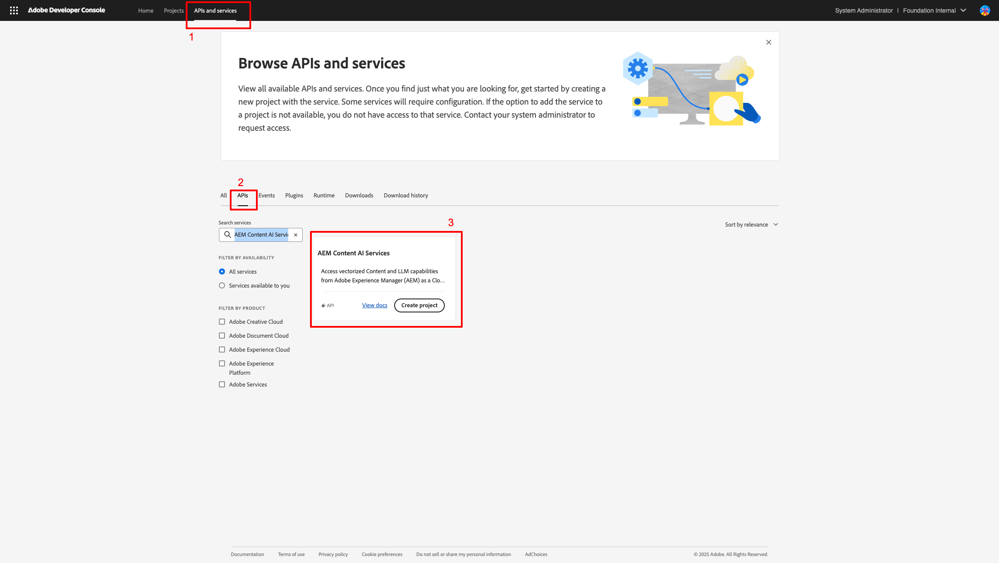

1. **AEM コンテンツ AI サービス**&#x200B;でフィルタリングし、新規プロジェクトを開始するには「**[!UICONTROL プロジェクトを作成]**」を選択し、既存のプロジェクトにサービスを追加する場合は「**[!UICONTROL API を追加]**」を選択します。

   >[!NOTE]
   >
   >API カードが「ライセンスは必須です」というメッセージと共に無効になっている場合、AEM as a Cloud Service 環境が最新化されていない場合があります。 詳しくは、[AEM as a Cloud Service 環境の最新化](https://experienceleague.adobe.com/ja/docs/experience-manager-learn/cloud-service/aem-apis/openapis/setup#modernization-of-aem-as-a-cloud-service-environment)を参照してください。

1. **[!UICONTROL API を設定]**&#x200B;ダイアログで、**[!UICONTROL サーバー間]**&#x200B;認証を選択します。

   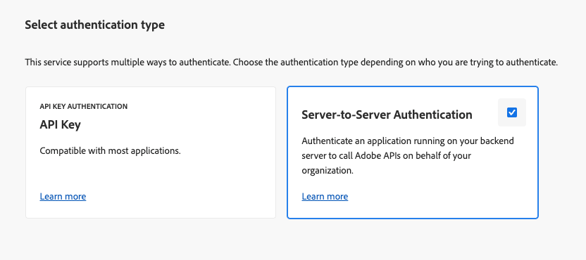

   >[!TIP]
   >
   >サーバー間オプションが使用できない場合、統合を設定するユーザーは製品プロファイルに開発者として追加されません。 詳しくは、[サーバー間認証を有効にする](https://developer.adobe.com/developer-console/docs/guides/authentication/ServerToServerAuthentication/implementation)を参照してください。

1. 必要に応じて、資格情報を名前変更します。 「**[!UICONTROL 次へ]**」を選択します。

   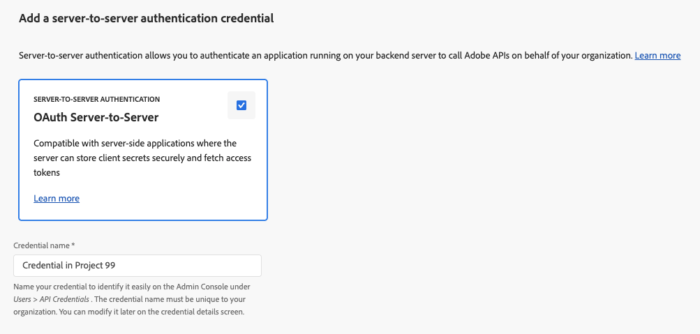

1. **[!UICONTROL AEM ユーザー - パブリッシュ - プログラム XXX - 環境 XXX]** や **[!UICONTROL AEM ユーザー - オーサー - プログラム XXX - 環境 XXX]** の製品プロファイルを選択し、「**[!UICONTROL 保存]**」を選択します。

   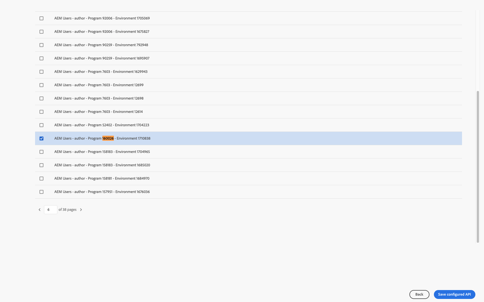

1. API と認証設定を確認します。

   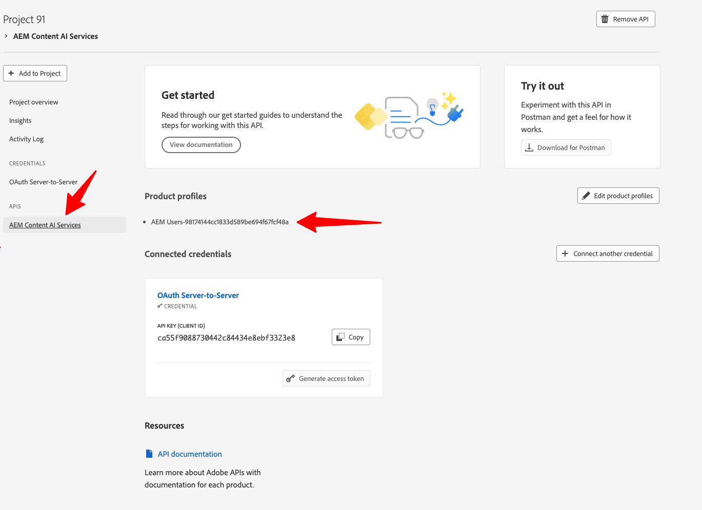

   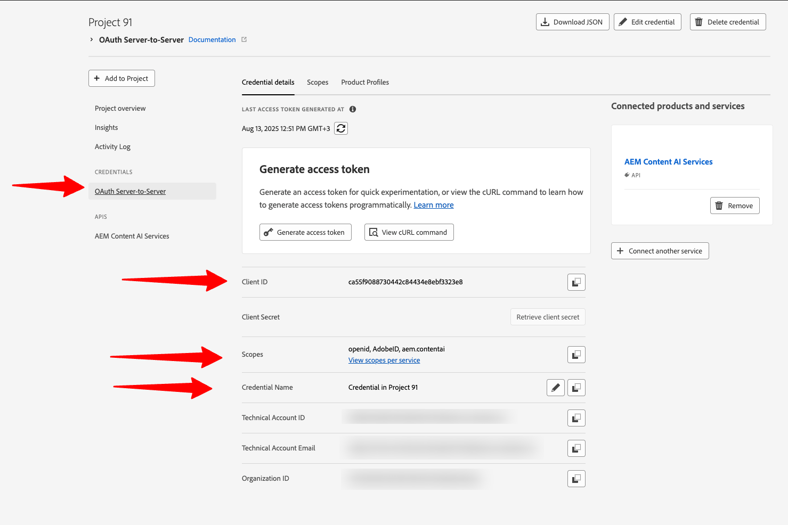

### アクセストークンの生成 {#generate-token}

1. ADC プロジェクトで、**[!UICONTROL 資格情報]**&#x200B;に移動し、「**[!UICONTROL アクセストークンを生成]**」を選択します。

   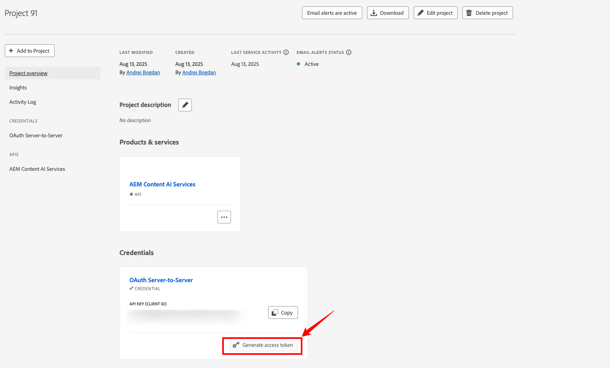

1. すべての API リクエストの `Authorization` ヘッダーにトークンを含めます。

   ```http
   Authorization: Bearer YOUR_ACCESS_TOKEN
   ```

   >[!WARNING]
   >
   >トークンは安全に保管してください。 有効期限があり、定期的に再生成する必要があります。

## API キー認証 {#api-key-auth}

1. プロジェクトに AEM Content AI Services API を追加する際は、**[!UICONTROL 認証タイプを選択]**&#x200B;ダイアログで「**[!UICONTROL API キー]**」を選択します。

   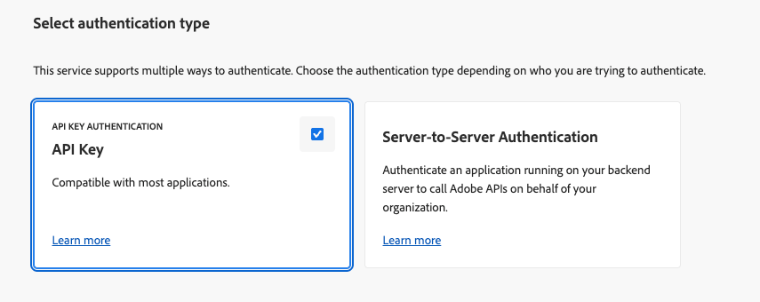

1. API キー資格情報を確認します。

   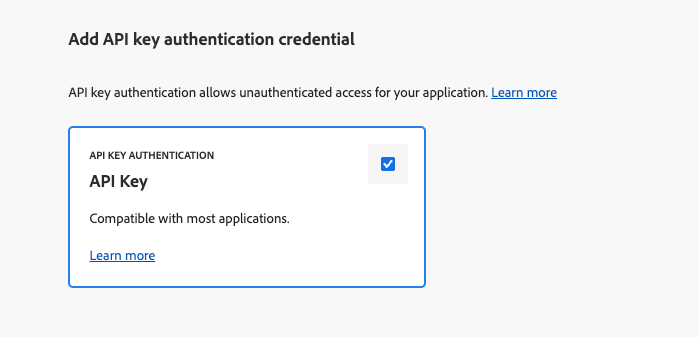

1. キーを使用できるオリジンを制限するには、許可されているドメインを設定します。

   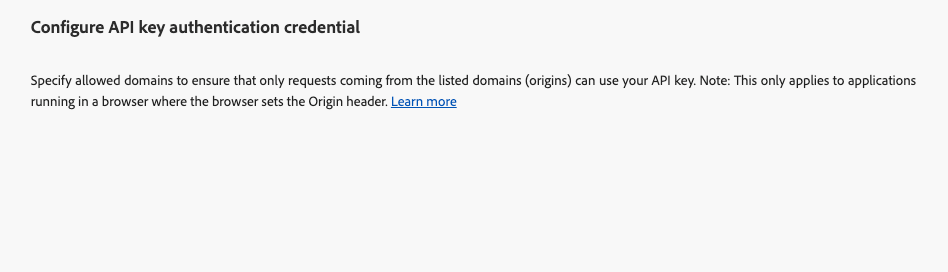

1. API キー（クライアント ID）は、**[!UICONTROL 接続済み資格情報]**&#x200B;の下に表示されます。 「**[!UICONTROL コピー]**」を選択します。

   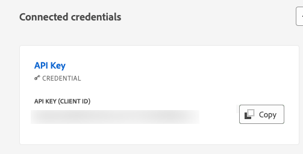

1. すべての API リクエストにキーを含めます。

   ```http
   x-api-key: YOUR_API_KEY
   ```

   プロジェクトの準備が整いました。 AEM コンテンツ AI サービスへのすべてのリクエストにこのキーを使用します。

## 次のステップ {#next-steps}

* [コンテンツソースの制御](contentsources.md) - Cloud Manager でコンテンツソースを設定し、取得をトリガーします。
* [Content AI API リファレンス](https://developer.adobe.com/experience-cloud/experience-manager-apis/api/experimental/contentai/) - アクセストークンまたは API キーを使用して、インデックス作成済みコンテンツのクエリを実行します。
